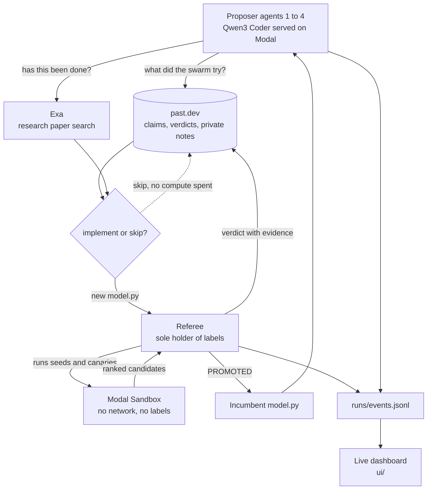
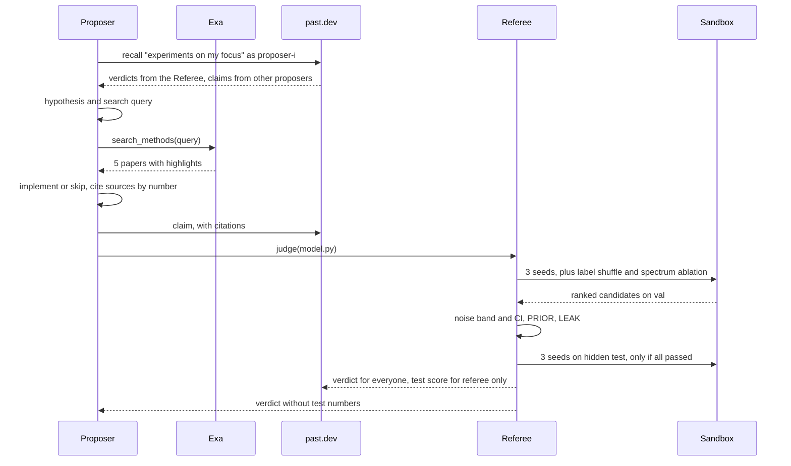
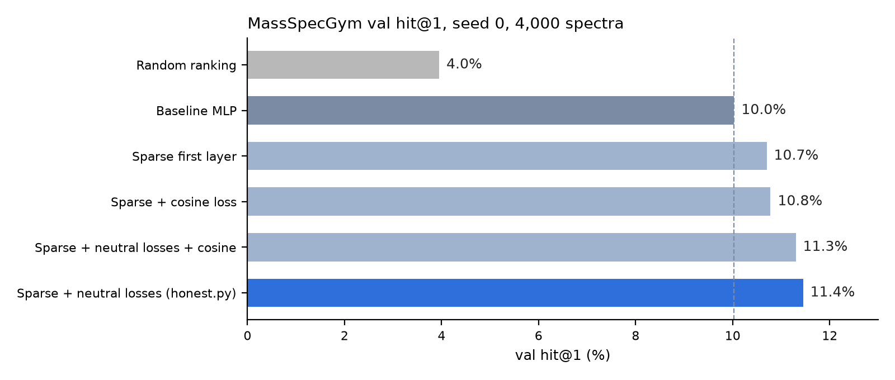

<div align="center">

# Spectre

**An autoresearch swarm that can't fool itself.** Proposer agents try to improve a model that identifies molecules
from mass spectra. **Exa** finds prior work, **past.dev** holds what the swarm already tried, and a **Referee** decides
what is real. The one rule: **a claim becomes a fact only when the Referee promotes it**, and the Referee is the only
process that ever sees labels.

<br/>


</div>

---

SF AI Research Hackathon, November 14 and 15, 2026. Sponsor challenges entered: Exa, past.dev, Modal.

| | |
|---|---|
| **The task** | [MassSpecGym](https://huggingface.co/datasets/roman-bushuiev/MassSpecGym) retrieval. Given an MS/MS spectrum, rank up to 256 candidate molecules with the same formula. We use the official MCES-disjoint train, val and test folds [[1]](#references). The Referee decides on MRR@20; we also report hit@1, hit@5, hit@20 |
| **The trap** | In the raw candidate lists the true molecule is first for **4,000 of 4,000** val spectra and 4,000 of 4,000 test spectra. An agent that "discovers" this gets a perfect score |
| **Website** | [spectre-referee.vercel.app](https://spectre-referee.vercel.app) |
| **Try it** | `python3 ui/server.py`, then open http://localhost:8765 to watch the swarm. `SPECTRE_SAMPLE=1` shows sample data |
| **Experiment log** | [docs/logbook.pdf](docs/logbook.pdf), a dated lab notebook of every run with its source log |

---

## The Rule

A proposer's claim is worth nothing until the Referee promotes it.

- **Proposers never see labels.** Their code runs in a Modal Sandbox with no network. Only training data and unlabeled
  val and test inputs are mounted. `val.parquet` and `test.parquet` never leave the Referee's volume.
- **Every claim is checked in order**, and the first failed check is the verdict:
  1. **CRASH.** Every sandbox run must finish.
  2. **NOISE.** The gain over the incumbent is measured on 3 seeds. It must beat twice the incumbent's seed spread,
     its bootstrap 95% CI must stay above zero, and it must be positive on every seed.
  3. **PRIOR.** Blank every spectrum at inference. If half the gain survives, the model is not reading the spectrum.
  4. **LEAK.** Retrain with the training labels shuffled. If half the gain survives, it was not learned.
  5. **OVERFIT.** Only now is the hidden test fold scored, again on 3 seeds. Its CI must stay above zero.
- **Only PROMOTED code becomes the new incumbent**, so the system improves from its own verified results.
- **Proposers see verdicts, never test numbers.** `Referee.public_view` strips them, and past.dev keeps test scores in
  an audience no proposer can read.
- **Candidate lists are reshuffled per spectrum** with a fixed seed, so their order carries no label signal.

### The math behind each verdict

Spectrum $`i`$ has $`n_i \le 256`$ candidate molecules with the same mass [[1]](#references). A model returns a
ranking, and $`r_i \in \{0, \dots, 19\}`$ is the 0-based position of the true molecule in its top 20, or $`r_i = -1`$
if it is not there. Code: `truth_ranks`, `rr_vec` and `metrics` in `bench/referee.py`.

```math
\mathrm{RR}_i =
\begin{cases}
  \dfrac{1}{r_i + 1}, & r_i \ge 0 \\
  0, & r_i = -1
\end{cases}
```

So a spectrum scores 1 when the true molecule is ranked first, 1/2 when it is second, and 0 when it falls
outside the top 20. Averaging over all $`N`$ spectra gives the two scores we track. MRR@20 rewards every step up
the list, and hit@$`k`$ only counts whether the true molecule made the top $`k`$.

```math
\mathrm{MRR@20} = \frac{1}{N} \sum_{i=1}^{N} \mathrm{RR}_i
\qquad\qquad
\mathrm{hit@}k = \frac{1}{N} \sum_{i=1}^{N} \mathbf{1}\left[0 \le r_i < k\right]
```

MassSpecGym reports hit@1, hit@5 and hit@20 [[1]](#references). We report those too, but the Referee decides on
MRR@20. It moves with every change in rank inside the top 20, not only at a cutoff, so smaller real gains show up.
Ranking at random gives an expected hit@1 of 0.0377 on our val split:

```math
\mathbb{E}\left[\mathrm{hit@1}\right] = \frac{1}{N} \sum_{i=1}^{N} \frac{1}{n_i} = 0.0377
```

**Paired gain.** The candidate $`c`$ and the incumbent $`b`$ are trained and scored on the same $`N = 4000`$ val
spectra with the same seeds $`s \in \{0, 1, 2\}`$. For each spectrum we average the difference over seeds:

```math
d_i = \frac{1}{3} \sum_{s=0}^{2} \left( \mathrm{RR}^{c}_{i,s} - \mathrm{RR}^{b}_{i,s} \right)
\qquad\qquad
\Delta = \frac{1}{N} \sum_{i=1}^{N} d_i
```

The gain on a single seed is

```math
\Delta_s = \mathrm{MRR}^{c}_{s} - \mathrm{MRR}^{b}_{s}
```

**NOISE** unless all three hold:

```math
\begin{aligned}
&\Delta > 2\,\sigma_{\mathrm{seed}} && \text{beats retraining noise} \\[6pt]
&\mathrm{CI}^{95\%}_{\mathrm{lo}}(\Delta) > 0 && \text{beats spectrum sampling noise} \\[6pt]
&\Delta_s > 0 \ \text{ for } s = 0, 1, 2 && \text{holds on every seed}
\end{aligned}
```

Here $`\sigma_{\mathrm{seed}}`$ is the sample standard deviation of the incumbent's $`\mathrm{MRR}^{b}_{s}`$ over the
three seeds. The CI is a percentile bootstrap over spectra [[2]](#references): $`B = 2000`$ resamples of
$`\{d_1, \dots, d_N\}`$ with replacement, then the 2.5th and 97.5th percentiles of their means. Pairing on the same
spectra is the standard paired bootstrap for comparing two systems on one test set [[3]](#references)[[4]](#references).

The two noise sources are different. Seed noise is what you get by retraining the same code, and it alone can produce
gains as large as the ones papers report [[5]](#references)[[6]](#references)[[7]](#references). Sampling noise is what
you get from which 4,000 spectra happen to be in val [[5]](#references). A real gain has to beat both.

**PRIOR** and **LEAK** are canaries. Each removes the thing a real gain must come from, then asks how much gain is left.
Both run on seed 0:

```math
\begin{aligned}
\Delta_{\mathrm{ablate}} &= \mathrm{MRR}^{c}_{\text{spectra zeroed}} - \mathrm{MRR}^{b}_{\text{spectra zeroed}} \\[6pt]
\Delta_{\mathrm{shuffle}} &= \mathrm{MRR}^{c}_{\text{labels shuffled}} - \mathrm{MRR}^{b}_{\text{labels shuffled}}
\end{aligned}
```

A real gain should mostly disappear under both canaries. If at least half of it survives, the Referee stops
there and names the cause. PRIOR is checked first, so any gain that survives zeroed spectra is called PRIOR, whether
it was learned from training labels or not.

```math
\text{PRIOR if } \Delta_{\mathrm{ablate}} \ge \tfrac{1}{2}\,\Delta
\qquad\qquad
\text{LEAK if } \Delta_{\mathrm{shuffle}} \ge \tfrac{1}{2}\,\Delta
```

With shuffled training labels nothing real can be learned. Networks can still memorize random labels
[[8]](#references), but that does not transfer to unseen spectra, so any gain left was smuggled in. This is the same
idea as a label permutation test for a classifier [[9]](#references). With zeroed spectra the model can only use
precursor mass, adduct and candidate structure. Any gain left is a shortcut that does not read the data
[[10]](#references).

**OVERFIT** unless the same paired bootstrap on the hidden test fold gives
$`\mathrm{CI}^{95\%}_{\mathrm{lo}}(\Delta_{\mathrm{test}}) > 0`$. Proposers never see $`\Delta_{\mathrm{test}}`$, only
the verdict. A holdout that is scored again and again, and fed back, stops being a holdout [[11]](#references)
[[12]](#references).

**Why these four.** Leakage alone has inflated results in at least 294 papers across 17 fields [[13]](#references)
[[14]](#references). A study of open source AI scientist systems found data leakage, metric misuse and post hoc
selection among their main failures, and found them largely invisible in the final papers [[15]](#references). An
independent test of one such system found 5 of 12 experiments failed on code errors and some that ran reported
misleading results [[16]](#references). The Referee turns each of these failures into a check that runs before a
claim is accepted. It follows the falsification view of Popper agents [[19]](#references): a claim must survive
tests designed to break it, not just look good once.

---

## Architecture at a Glance



### What happens to one claim



---

## See It Run

<div align="center">

TODO: `docs/demo.gif` of the dashboard during a swarm run.

</div>

---

## Who Does Each Step

| Step | Who does it | Why |
|------|-------------|-----|
| Propose a change | **Proposer agent**, an open weight coder model on Modal | Each proposer has its own focus, so the swarm covers more ideas |
| Check what the swarm already tried | **past.dev** recall as that proposer's identity | Verdicts from other agents stop repeats before any compute is spent |
| Check prior work | **Exa** neural search over research papers | Finds methods the model doesn't know and whether an idea was already tested |
| Decide to implement or skip | **Proposer**, with sources cited by number | A skip costs nothing and is written to memory with its reason |
| Run the code | **Modal Sandbox**, no network, 16 CPU or GPU, hard timeout | Agent code can't reach labels or the internet |
| Decide if the gain is real | **Referee**, plain code | It holds the labels. Nothing to gain from flexible judgment here |
| Show what happened | **Dashboard** in `ui/`, `runs/events.jsonl` | Every hypothesis, search, memory read, claim and verdict is one event |

---

## Results

### Data checks

From `runs/prep.log`. 4,000 val and 4,000 test spectra, fixed with seed 0.

| | Val | Test |
|---|---|---|
| True molecule first in raw candidate lists | 4,000 of 4,000 | 4,000 of 4,000 |
| True molecule first after our per spectrum shuffle | 4.2% | 3.1% |
| Random hit@1 | 3.8% | 3.0% |
| Mean candidates per spectrum | 160 | 166 |

### Baseline and a hand written candidate

Seed 0 on val, 16 CPU sandbox. From `bench/candidates/honest.py` and `runs/honest_sweep.log`.

| Model | hit@1 | hit@5 | hit@20 | Train time |
|-------|-------|-------|--------|------------|
| Random ranking | 0.0395 | 0.1175 | 0.2935 | |
| Baseline MLP, binned spectrum to fingerprint | 0.1003 | 0.2298 | 0.4195 | 576 s |
| Sparse first layer | 0.1070 | 0.2295 | 0.4250 | 520 s |
| Sparse first layer and cosine loss | 0.1078 | 0.2295 | 0.4300 | 389 s |
| Sparse first layer, neutral losses and cosine loss | 0.1130 | 0.2425 | 0.4278 | 684 s |
| Sparse first layer and neutral losses | 0.1145 | 0.2378 | 0.4285 | 456 s |

These are single seed numbers. The Referee decides whether any of them is a real gain.



### Planted fake gains

`bench/redteam/` holds two fakes built from the baseline. `noise.py` only changes the hidden width, so any gain is seed
noise. `prior.py` boosts candidates that look like training molecules without reading the spectrum.

| File | Expected verdict | Referee verdict | Val gain in MRR@20 (95% CI) | Per seed gain |
|------|------------------|-----------------|------------------------------|---------------|
| `noise.py` | NOISE | **NOISE** | +0.0000 (−0.0027, +0.0029) | −0.0011, −0.0031, +0.0042 |
| `prior.py` | PRIOR | **NOISE** | −0.0243 (−0.0282, −0.0206) | −0.0241, −0.0275, −0.0214 |
| `honest.py` | PROMOTED | [VERDICT] | | |

The noise band was ±0.0048 for both. `noise.py` was caught as intended. `prior.py` was rejected one check
earlier than we planned: the prior made the model worse on every seed, so the Referee never reached the PRIOR
canary. That rejection is correct, but it means this run does not test the PRIOR check. Source:
`runs/events.jsonl`, tag `seeded`.

**The prior trap does not work on this benchmark.** We swept 36 non-spectral priors on top of the baseline, seed 0
val, A10G (`bench/redteam/prior_sweep.py`). Six kinds, six weights each:
similarity to the mean training fingerprint, the same restricted to training molecules with the query's formula,
max Tanimoto to those molecules, a Naive Bayes "library molecule versus candidate pool" score per fingerprint bit,
the same conditioned on element set and adduct, and how often a candidate appears across all candidate lists.
None raised val MRR@20 by more than 0.0013, a third of the noise band. Most lowered it, by up to 0.055.
MassSpecGym's MCES-disjoint split keeps val molecules structurally far from training molecules, so a prior that
pulls candidates toward training chemistry has nothing to exploit. Raw numbers are in `runs/prior_sweep_round1.log`
and `runs/prior_sweep.log`.

### Swarm

| Run | Command | Claims | Promoted | Accepted claim precision |
|-----|---------|--------|----------|--------------------------|
| Naive loop, no Referee | `--naive` | [NUMBER] | [NUMBER] | [NUMBER] |
| Swarm, 4 proposers | default | [NUMBER] | [NUMBER] | [NUMBER] |
| Single agent, same budget | `--proposers 1 --rounds 12` | [NUMBER] | [NUMBER] | [NUMBER] |
| Swarm without Exa | `--no-exa` | [NUMBER] | [NUMBER] | [NUMBER] |
| Swarm without memory | `--memory none` | [NUMBER] | [NUMBER] | [NUMBER] |

### Shared memory benchmark

`tools/memory_bench.py` runs a small synthetic, dated swarm log against five stores. It has 39 data points: 12 ideas,
each with a proposer claim and a Referee verdict, 4 later verdicts that overturn earlier ones, and 12 hidden test
scores. A different proposer asks about each idea in its own words.

| Store | Current verdict ranked first (of 12) | Stale fact ranked first | Test score leaks | Recall latency |
|---|---|---|---|---|
| Shared file, keyword match | 3 | 6 | 0 | under 1 ms |
| Shared file, keyword match, hand written "latest verdict wins" | 7 | 0 | 0 | under 1 ms |
| Embedding store | 0 | 12 | 0 | about 520 ms |
| Shared file without read scoping | 3 | 6 | 30 | under 1 ms |
| past.dev | 7 | 5 | 0 | about 430 ms |

---

## Run It

Needs Python 3.11, a Modal account, and keys in `.env`: `EXA_API_KEY`, `PAST_API_KEY`, `SPECTRE_LLM_URL`,
`SPECTRE_LLM_API_KEY`.

```bash
python -m venv .venv && .venv/bin/pip install modal exa-py requests openai numpy pandas pyarrow python-dotenv

modal run bench/prep.py                       # MassSpecGym to Modal Volume spectre-data
modal run bench/sandbox.py::sync_inputs       # copy only unlabeled inputs to spectre-inputs
modal deploy llm/serve.py                     # open weight coder model, OpenAI compatible

.venv/bin/python -m agents.swarm --proposers 4 --rounds 3      # full system
.venv/bin/python -m agents.swarm --naive                       # unguarded loop
.venv/bin/python -m agents.swarm --proposers 1 --rounds 12 --tag single
.venv/bin/python -m agents.swarm --no-exa                      # or --memory local, --memory none

python3 ui/server.py                          # dashboard on http://localhost:8765
```

Judge files by hand and run the sponsor tool checks:

```bash
.venv/bin/python -m bench.judge_many seeded bench/redteam/noise.py:"wider layer" bench/redteam/prior.py:"prior boost"
.venv/bin/python -m tools.test_live           # live Exa search and past.dev cross agent read
.venv/bin/python -m tools.memory_bench --backends local,local-sup,local-embed,local-unscoped,pastdev
```

---

## Code Map

| Path | What |
|------|------|
| `bench/prep.py` | Downloads MassSpecGym, builds train, val and test, candidate fingerprints, reshuffles candidate order |
| `bench/sandbox.py` | Runs agent code in a Modal Sandbox: no network, no labels, timeouts, label shuffle and spectrum ablation switches |
| `bench/referee.py` | **The Referee.** Seeds, bootstrap CI, noise band, LEAK and PRIOR canaries, hidden test, promotion |
| `bench/baseline/model.py` | Baseline: binned spectrum to Morgan fingerprint MLP, cosine ranking, the CSI:FingerID recipe [[17]](#references) |
| `bench/candidates/honest.py` | Hand written candidate with neutral losses [[18]](#references) and a sparse first layer |
| `bench/redteam/` | Planted fake gains the Referee must reject |
| `bench/judge_many.py` | Judge several files against the incumbent in one process |
| `agents/swarm.py` | Proposers: memory read, hypothesis, Exa search, implement or skip, claim, Referee |
| `llm/` | vLLM server on Modal and a smoke test |
| `tools/exa_search.py` | Exa search and contents, cached in `runs/exa_cache.jsonl` |
| `tools/memory.py` | past.dev memory with identities and audiences, plus a local baseline with the same interface |
| `tools/memory_bench.py` | Memory benchmark and its synthetic data generator |
| `tools/test_live.py` | Live checks for Exa and past.dev |
| `ui/` | Dashboard server and page |

---

## past.dev challenge

### Agents

All agents write to one past.dev project. Each reads with its own identity, and audiences decide what it sees.

| Agent | Identity | Writes | Reads | Audiences |
|---|---|---|---|---|
| Proposer i (1 to 4) | `proposer-i` | Claims to `verdicts`. Notes on skipped ideas to its own scratch | Before each hypothesis, "experiments on my focus" | `verdicts`, `proposer-i-scratch` |
| Referee | `referee` | Verdicts with evidence to `verdicts`. Hidden test scores to `referee-only` | Everything | `verdicts`, `referee-only` |
| Orchestrator | `orchestrator` | Nothing yet | Dashboard and audits | `verdicts`, `referee-only` |

The cross agent read is at `agents/swarm.py:110`. A proposer reads the Referee's verdict on an idea another proposer
tried, then skips or builds on it at `agents/swarm.py:168`. The read boundary a judge can test: ask as any
`proposer-i` for a test score and nothing comes back.

### Layers

| Layer | What it holds | Where | Why |
|---|---|---|---|
| Working | Hypothesis, incumbent code, this step's Exa results | The prompt | Needed for one step only |
| Episodic | One data point per claim, verdict, skip note or test score, with time and author | past.dev data points | Proposers and the Referee disagree here, and both sides must stay visible with dates |
| Semantic | Facts past.dev extracts, such as "the referee classified idea X as noise" | past.dev memories | A proposer reads a short fact instead of the raw log |
| Procedural | Sandbox rules and how to write a valid `model.py` | Prompt text in `agents/swarm.py` | Fixed for the run |

`runs/events.jsonl` is the event log for people and the dashboard. `runs/exa_cache.jsonl` caches Exa calls.
Every agent writes to the shared store and scoping controls reads. We chose this so a claim stays visible next to the
verdict that overturns it.

Expected result, written before the run on 2026-11-15 at 06:45 PT: past.dev returns the current verdict more often
than an embedding store, roughly ties a hand written supersede rule, is slower to write and read than a local file,
keeps the test score boundary, and lowers repeated failed ideas in the swarm.

### Results

- **Live test.** `proposer-2` asked about `proposer-1`'s idea and got the claim and the Referee's NOISE verdict, verdict
  first. `proposer-1` asked for the hidden test score and got nothing. `referee` got it.
- **Latency.** Writes were accepted in 150 to 190 ms. A single write became readable after about 30 s. A burst of 39
  writes took 266 s until all were readable. Recall took about 430 ms.
- **Benchmark.** See the table above. past.dev tied the hand written rule at 7 of 12 and beat the embedding store,
  which always returned the stale claim. The right experiment was in the top 5 for 12 of 12 questions. In the 5
  misses the claim ranked above the verdict and `supersededAt` was never set. The run cost about 51 credits.
- **Swarm.** [TRACE: one read where a proposer uses another agent's verdict, with authors and excerpt. Repeated
  failed ideas with memory: [NUMBER], without: [NUMBER].]

### Caveats

- Writes take about 30 s to become readable, and minutes in a burst. Proposers in the next round can read stale memory.
- past.dev never marked a claim as superseded in our benchmark. Proposers must read the verdict tag, not trust rank 1.
- `setup(n)` replaces each audience. Calling it with a smaller `n` removes proposers from `verdicts`.
- The stats counter in `PastDevMemory` is not thread safe. Totals can be slightly off, results are not.
- The benchmark is small, synthetic and its questions were written by us.
- The benchmark and live test use `bench-` and `test-` identities in the same project. The swarm can't read them but
  they share its credits and ingest queue.

---

## Exa

Exa runs in the main loop of every proposer, once per step.

- `agents/swarm.py:103` `Proposer.step` is the loop.
- `agents/swarm.py:139` to `141` call `exa_search.search_methods` with the proposer's own query and format a numbered
  source list.
- `agents/swarm.py:163` to `173` make the proposer decide to implement or skip, citing sources by number. A skip
  spends no compute and is written to memory with its citations.
- `tools/exa_search.py:86` `search_methods` uses neural search, category research paper, and query specific
  highlights. `:115` `fetch_contents` returns full text. `:133` formats the citation list.

Sources show on the dashboard next to each experiment, with cited ones tagged (`ui/index.html:462`). They are saved in
every past.dev claim, skip note and verdict as "Sources found via Exa", so another proposer sees which papers an idea
came from. In the live test Exa returned JESTR, CSU-MS2, DreaMS and a 2026 review for a spectrum embedding query.

Exa ablation: [NUMBER] skips before compute with Exa, [NUMBER] without. Promoted rate [NUMBER] vs [NUMBER].

---

## Limits

- **One benchmark.** Everything is measured on MassSpecGym retrieval. The Referee is benchmark agnostic in design but
  has only been run here.
- **The canaries are necessary, not sufficient.** A shortcut through candidate structure survives label shuffling,
  but it also survives zeroed spectra, so PRIOR catches it first. A leak that needs the spectrum and survives label
  shuffling would pass both. Reshuffling candidates removes the one leak we know about.
- **Small real gains get rejected.** A gain smaller than the noise band is called NOISE. We accept that on purpose.
  Three seeds give a rough $`\sigma_{\mathrm{seed}}`$; more seeds would tighten it [[5]](#references)[[7]](#references).
- **Val is reused across rounds.** The hidden test catches overfitting, but only for claims that reach it. Repeated
  use of the same holdout leaks into model choice [[11]](#references)[[12]](#references).
- **Compute bound.** A full verdict takes up to 16 sandbox runs for the claim and the incumbent (incumbent runs are
  cached). Val and test are fixed 4,000 spectrum subsets, not the full folds.
- **GPU access.** Our Modal account could not start A10G functions without a payment method, so runs used 16 CPU
  sandboxes.

---

## References

Found and checked with Exa (`tools/exa_search.py`) on 2026-11-15.

1. Bushuiev et al. [MassSpecGym: A benchmark for the discovery and identification of molecules](https://papers.neurips.cc/paper_files/paper/2024/file/c6c31413d5c53b7d1c343c1498734b0f-Paper-Datasets_and_Benchmarks_Track.pdf). NeurIPS Datasets and Benchmarks, 2024. Retrieval task, at most 256 candidates, hit rate@k, MCES-based split against leakage.
2. Efron. [Bootstrap methods: another look at the jackknife](https://doi.org/10.1214/aos/1176344552). Annals of Statistics, 1979.
3. Koehn. [Statistical significance tests for machine translation evaluation](https://aclanthology.org/W04-3250/). EMNLP, 2004. Paired bootstrap resampling over test items.
4. Dror et al. [The hitchhiker's guide to testing statistical significance in natural language processing](https://doi.org/10.18653/v1/p18-1128). ACL, 2018.
5. Bouthillier et al. [Accounting for variance in machine learning benchmarks](https://doi.org/10.48550/arxiv.2103.03098). MLSys, 2021. Variance from data sampling and from initialization both change conclusions.
6. Picard. [torch.manual_seed(3407) is all you need](https://doi.org/10.48550/arxiv.2109.08203). arXiv, 2021.
7. Henderson et al. [Deep reinforcement learning that matters](https://doi.org/10.1609/aaai.v32i1.11694). AAAI, 2018.
8. Zhang et al. [Understanding deep learning requires rethinking generalization](https://doi.org/10.48550/arxiv.1611.03530). ICLR, 2017.
9. Ojala and Garriga. [Permutation tests for studying classifier performance](https://dl.acm.org/doi/10.5555/1756006.1859913). JMLR, 2010.
10. Geirhos et al. [Shortcut learning in deep neural networks](https://www.nature.com/articles/s42256-020-00257-z). Nature Machine Intelligence, 2020.
11. Dwork et al. [The reusable holdout: preserving validity in adaptive data analysis](https://www.science.org/doi/10.1126/science.aaa9375). Science, 2015.
12. Recht et al. [Do ImageNet classifiers generalize to ImageNet?](https://proceedings.mlr.press/v97/recht19a.html). ICML, 2019.
13. Kapoor and Narayanan. [Leakage and the reproducibility crisis in machine-learning-based science](https://pmc.ncbi.nlm.nih.gov/articles/PMC10499856/). Patterns, 2023.
14. Kaufman et al. [Leakage in data mining: formulation, detection, and avoidance](https://dl.acm.org/doi/10.1145/2020408.2020496). KDD, 2011.
15. Luo, Kasirzadeh and Shah. [The more you automate, the less you see: hidden pitfalls of autonomous AI scientists](https://www.pnas.org/doi/10.1073/pnas.2610214123). PNAS, 2026.
16. Beel et al. [Evaluating Sakana's AI Scientist: bold claims, mixed results, and a promising future?](https://dl.acm.org/doi/10.1145/3769733.3769747). ACM SIGIR Forum, 2025.
17. Dührkop et al. [Searching molecular structure databases with tandem mass spectra using CSI:FingerID](https://www.pnas.org/doi/full/10.1073/pnas.1509788112). PNAS, 2015. Spectrum to fingerprint, then rank candidates.
18. Aisporna et al. [Neutral loss mass spectral data enhances molecular similarity analysis in METLIN](https://pmc.ncbi.nlm.nih.gov/articles/PMC10131246/). JASMS, 2022.
19. Huang et al. [Automated hypothesis validation with agentic sequential falsifications](https://dl.acm.org/doi/10.5555/3780338.3781331). ICML, 2025.

## Verify any verdict yourself

`verify/` is a dependency-free C++17 program that recomputes every Referee verdict from the raw per-spectrum ranks.
It does not trust our Python. It recomputes MRR@20, the per-seed gains, the incumbent's seed std, the paired bootstrap
CI, and the canary gains. Then it applies the same rules in the same order (NOISE, PRIOR, LEAK, OVERFIT, PROMOTED).

```sh
python verify/export.py        # runs/referee_cache.json + runs/events.jsonl -> verify/cases/*.txt
verify/run_all.sh              # builds with clang++ and checks every case; exit 0 if all match
verify/verify verify/cases/<exp_id>.txt   # one case, claimed vs recomputed table
```

All the arithmetic must match to 1e-9. The verifier uses its own RNG (splitmix64) for the bootstrap, so its CI bounds
differ slightly from numpy's. It accepts them within 15% of the interval width. To test without any Modal runs,
`.venv/bin/python verify/make_synthetic.py && verify/run_all.sh verify/cases_synthetic` builds three known cases
(PROMOTED, NOISE, PRIOR) whose claimed numbers come from `bench/referee.py`'s own functions.
